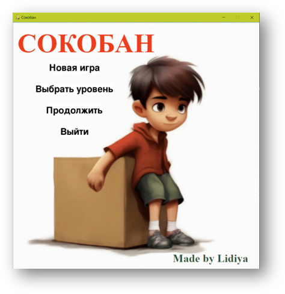
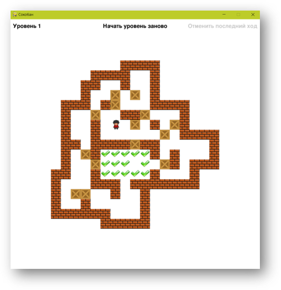

# 🎮 Логическая игра «Сокобан» (Sokoban)

Учебный проект по разработке классической игры-головоломки на Python. Игроку необходимо расставить ящики по обозначенным местам лабиринта, толкая их по одному в разные стороны.

## 📸 Скриншоты игры

**Главное меню:**

**Игровой процесс:**

## 🛠 Технический стек
*   **Язык:** Python
*   **Основная библиотека:** Pygame (отрисовка графики, работа со спрайтами, обработка событий).
*   **Работа с файлами:** 
    *   `json` — сохранение прогресса (последнего уровня).
    *   `os` — проверка наличия файлов уровней на диске.
    *   `sys` — корректный выход из приложения.
*   **Стандартные модули:** `copy` (глубокое копирование состояния уровня для отмены хода).

## 💡 Ключевые навыки, отработанные в проекте
*   **Объектно-ориентированное программирование (ООП):** Архитектура разделена на 7 логических классов (`Main`, `Game`, `Level`, `Player`, `StartMenu`, `LevelMenu`, `GameMenu`).
*   **Игровая логика:** Реализация механики движения, проверка коллизий (столкновение со стенами и ящиками), обработка отмены хода и перезапуска уровня.
*   **Работа с графикой:** Использование спрайтов (поворот героя в зависимости от направления движения), отрисовка карт уровней.
*   **Соответствие стандартам:** Код соответствует PEP 8, константы вынесены в отдельный файл (`constants.py`), используются «говорящие» имена переменных.
*   **Git:** Работа с ветками (создание ветки `develop`, пошаговые коммиты, слияние в `master`).

## 📂 Структура репозитория
*   `*.py` — исходный код игры (7 модулей) лежит в корне репозитория.
*   `data/` — ресурсы игры:
    *   `Картинки/` — спрайты, фоны, элементы интерфейса.
    *   `Шрифты/` — шрифты.
    *   `Уровни/` — текстовые файлы с уровнями игры.
    *   `Screenshots/` — скриншоты для документации.
*   `README.md` — описание проекта.
*   `instructions.md` — **правила игры и управление**.
*   `requirements.txt` — зависимости.
*   `last_level` — файл для хранения номера последнего уровня.

## 📚 Документация
*   📜 **[Инструкция к игре (instructions.md)](./instructions.md)** — как играть и управление.
*   📊 **[Презентация проекта (PDF)](./Презентация%20проекта.pdf)** — визуальное описание истории создания, архитектуры и этапов работы.
